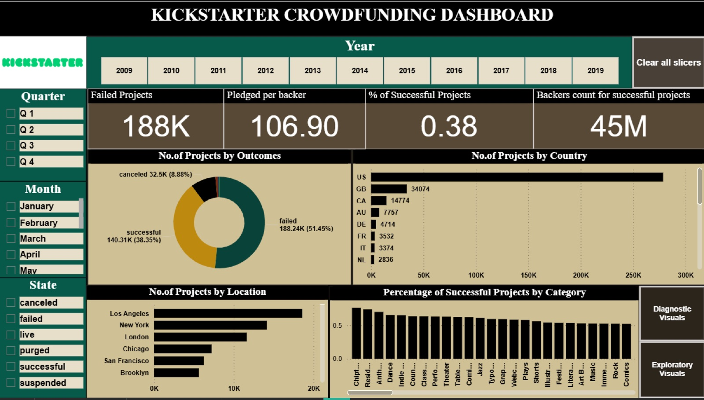
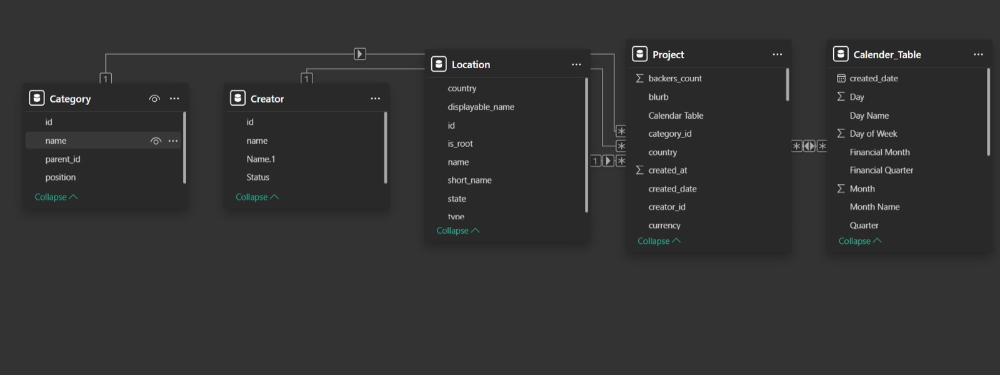
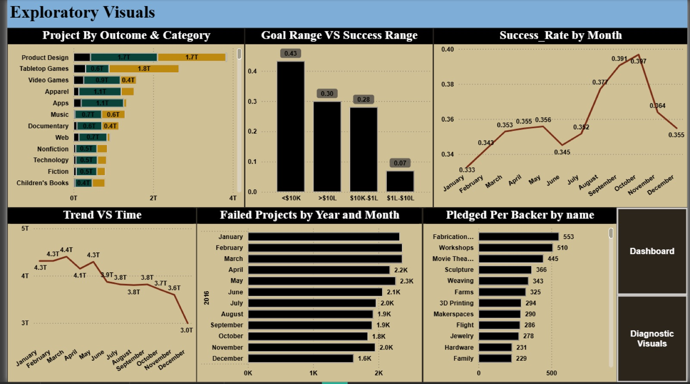
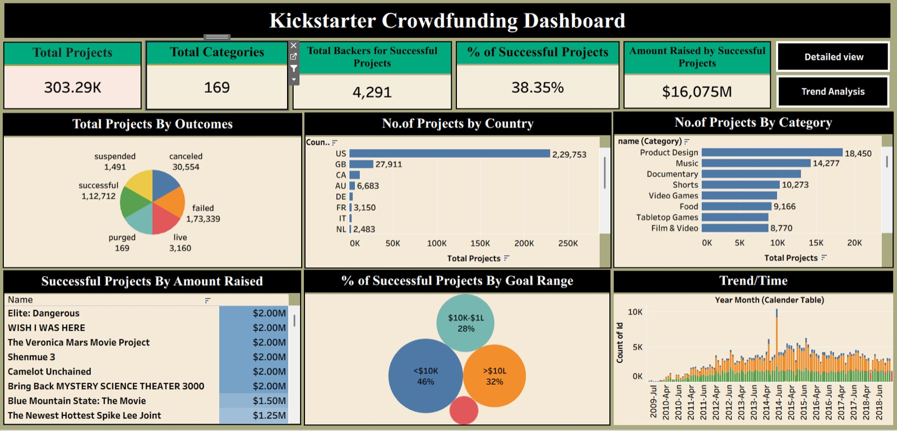
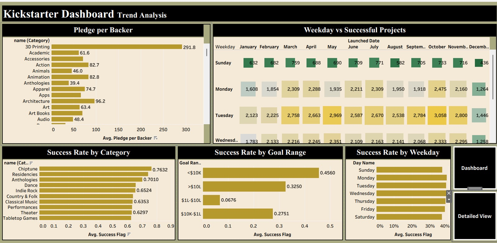
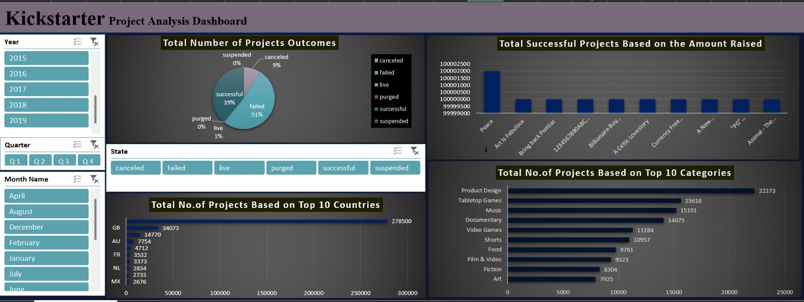

# Kickstarter Crowdfunding Analysis

**Tools:** Power BI · Tableau · Excel · MySQL

What makes a crowdfunding campaign succeed? Analysis of 300K+ Kickstarter projects (2009–2019) across category, country, goal size and launch timing — built three times, in Excel, Power BI and Tableau.

## Key findings

- **38% of projects succeed**; 51% fail and ~9% are cancelled.
- **Smaller goals win:** projects with goals under $10K succeed ~46% of the time; very large goals rarely do.
- **Category matters:** Chiptune, Residencies and Dance have the highest success rates (65%+). 3D Printing has the highest average pledge per backer (~$292).
- **Timing matters:** success rate climbs from January to a peak in October; Monday and Tuesday launches outperform weekends.
- **The US dominates** with ~230K projects, followed by the UK, Canada and Australia.

## Approach

1. **Data cleaning (Excel)** — converted Epoch timestamps to dates, built a calendar table (year, quarter, month, financial month/quarter) and converted all goal amounts to USD.
2. **Data model** — star schema with `Project` as the fact table and `Category`, `Creator`, `Location` and `Calendar` dimensions.

   

3. **SQL ([`sql/kickstarter_data_model.sql`](sql/kickstarter_data_model.sql))** — renamed keys, built a category dimension and a `project_analysis` view joining projects to category and location.
4. **Dashboards** — KPI cards (failed projects, pledged per backer, % successful, backers), slicers for year/quarter/month/state, plus exploratory and diagnostic pages.

## Screenshots

| Power BI — Exploratory | Tableau — Overview |
|---|---|
|  |  |

| Tableau — Trend Analysis | Excel — Dashboard |
|---|---|
|  |  |

More Excel views: [analysis 1](screenshots/excel-analysis-1.jpg), [analysis 2](screenshots/excel-analysis-2.jpg).

## Files

| File | Description |
|------|-------------|
| `sql/kickstarter_data_model.sql` | Table clean-up and analysis view |
| `screenshots/` | Dashboard screenshots from Power BI, Tableau and Excel |

> The Power BI file (`.pbix`, ~130 MB) is larger than GitHub's file limit and is available on request.
